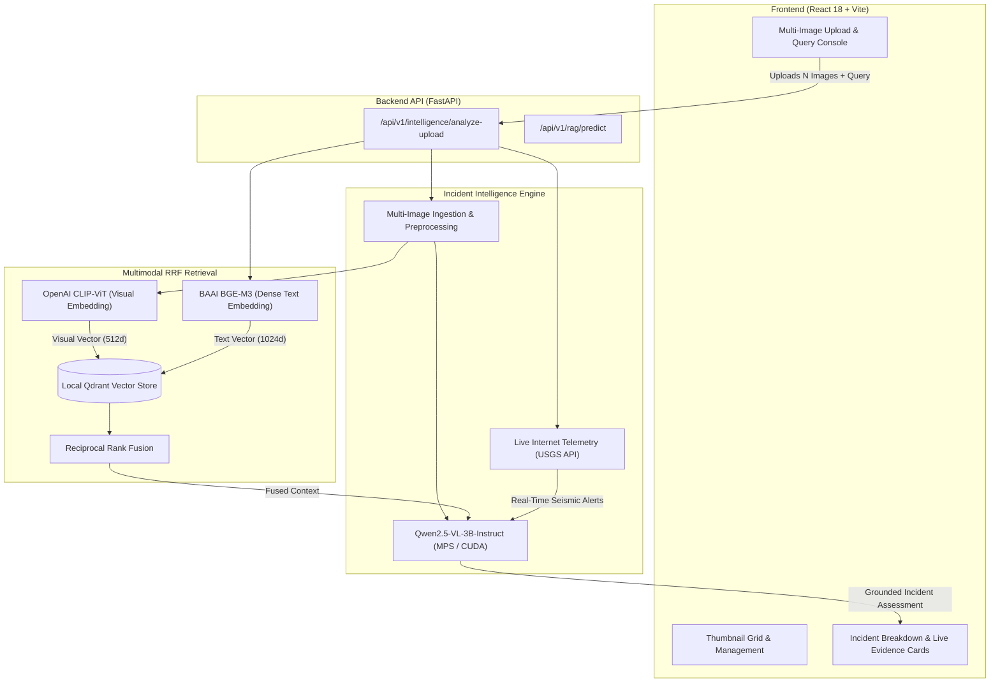

# 🛰️ DisasterMind: Multimodal RAG & Disaster Intelligence Platform

[](https://fastapi.tiangolo.com)
[](https://pytorch.org)
[](https://react.dev)
[](https://vitejs.dev)
[](https://qdrant.tech)
[](LICENSE)

**DisasterMind** is an end-to-end multimodal Retrieval-Augmented Generation (RAG) and situational intelligence platform designed for rapid disaster damage assessment, satellite and aerial imagery interpretation, and emergency response coordination. Built on the **DisasterM3** benchmark and empowered by local Vision-Language Models (VLM), dense vector retrieval, and live global telemetry feeds.

---

## 🌟 Key Features

- **📸 Multi-Image Scene Upload & Analysis**: Ingest and process multiple disaster scenes at once—including pre/post-disaster satellite pairs, drone aerial sweeps, and ground-level structural observations.
- **🔬 Real Local Multimodal Reasoning (Qwen2.5-VL)**: Powered by `Qwen/Qwen2.5-VL-3B-Instruct` running locally on Apple Silicon (MPS) or NVIDIA CUDA with dynamic memory optimization.
- **🏛️ 4-Pillar Incident Intelligence**: Structured, clean assessment breakdowns with zero canned or mock data:
  1. **📌 What Happened**: Disaster event classification and visual damage detection.
  2. **📍 Where It Happened**: Geographic sector identification and affected infrastructure zones.
  3. **⚡ How It Happened**: Physical mechanics, seismic fault ruptures, storm surges, or collapse triggers.
  4. **⚠️ Impact & Severity**: Building collapse counts, road blockages, and priority emergency recommendations.
- **🔍 Reciprocal Rank Fusion (RRF) Multimodal Retrieval**:
  - **Dense Text Retrieval**: 1024-dimensional semantic embeddings via `BAAI/bge-m3`.
  - **Visual Embedding Search**: 512-dimensional visual representations via `openai/clip-vit-base-patch32`.
  - **Embedded Vector Database**: Disk-persisted local Qdrant collection (`disasterm3_historical`).
- **⚡ Live Internet Disaster Telemetry**: Direct real-time correlation with live online feeds:
  - **USGS Earthquake Hazards Program** (real-time seismic telemetry and shaking alerts).
  - **GDACS & ReliefWeb** crisis monitoring bulletins.
- **✨ High-Performance Dark Glassmorphism UI**: Interactive React dashboard with drag-and-drop multi-file gallery, live status badges, latency timers, and dataset benchmark visualizations.

---

## 🏛️ System Architecture



---

## 📁 Repository Structure

```text
DisasterMind/
├── Backend/
│   ├── app/
│   │   ├── main.py                  # FastAPI application & API endpoints
│   │   ├── schemas/                 # Pydantic v2 data models
│   │   │   ├── intelligence.py      # Incident breakdown & evidence schemas
│   │   │   ├── rag.py               # RAG request & response schemas
│   │   │   ├── retrieval.py         # Qdrant retrieval schemas
│   │   │   └── vlm.py               # Vision-Language inference schemas
│   │   └── services/                # Core domain services
│   │       ├── clip_service.py      # OpenAI CLIP image embedding service
│   │       ├── embedding_service.py # BGE-M3 text embedding service
│   │       ├── intelligence_service.py # Multi-image intelligence pipeline
│   │       ├── multimodal_service.py   # RRF multimodal retrieval service
│   │       ├── qdrant_service.py    # Local disk Qdrant index service
│   │       ├── rag_service.py       # Grounded RAG prediction pipeline
│   │       └── vlm_service.py       # Qwen2.5-VL vision-language service
│   ├── data/
│   │   ├── qdrant/                  # Local vector storage database
│   │   └── uploads/                 # Uploaded disaster imagery
│   ├── docs/                        # Architectural documentation
│   ├── requirements.txt             # Python dependencies
│   └── tests/                       # Automated test suites
├── Frontend/
│   ├── src/
│   │   ├── App.jsx                  # Main dashboard application
│   │   ├── index.css                # Glassmorphism design tokens & styles
│   │   └── main.jsx                 # React root entry point
│   ├── package.json                 # Node.js dependencies & scripts
│   └── vite.config.js               # Vite bundler configuration
└── README.md                        # Project documentation
```

---

## 🚀 Quick Start Guide

### Prerequisites
- **Python**: 3.10+ (tested with 3.10 – 3.14)
- **Node.js**: 18+ and npm
- **Hardware**: Compatible with macOS Apple Silicon (M1/M2/M3/M4) or Linux/Windows with CUDA GPU.

---

### 1. Backend Setup

```bash
# Navigate to Backend directory
cd Backend

# Create and activate Python virtual environment
python3 -m venv venv
source venv/bin/activate  # On Windows: venv\Scripts\activate

# Install dependencies
pip install -r requirements.txt

# Start the FastAPI server
uvicorn app.main:app --host 0.0.0.0 --port 8000
```

The backend server will start at **`http://localhost:8000`**.  
Interactive Swagger documentation is available at **`http://localhost:8000/docs`**.

---

### 2. Frontend Setup

In a new terminal window:

```bash
# Navigate to Frontend directory
cd Frontend

# Install Node dependencies
npm install

# Start Vite development server
npm run dev
```

The application interface will open at **`http://localhost:3000`**.

---

## 📡 API Reference

### Health & System Status
- **`GET /health`**
  - Returns service status and Qdrant index point counts.

### Incident Intelligence & Multi-Image Upload
- **`POST /api/v1/intelligence/analyze-upload`**
  - Accepts `multipart/form-data`:
    - `images`: One or more image files (PNG, JPG, GeoTIFF, WebP).
    - `question`: Natural language inquiry (e.g., *"What disaster happened here and what caused it?"*).
    - `search_live`: Boolean flag to correlate with live USGS and GDACS disaster feeds.
    - `engine_mode`: `"fast"` (rapid triage) or `"deep_vlm"` (full local Qwen2.5-VL reasoning).

### Multimodal RAG Prediction
- **`POST /api/v1/rag/predict`**
  - Grounded question answering with provenance audit trail using the DisasterM3 historical corpus.

### Real-Time Live Feed Explorer
- **`GET /api/v1/live-feed/recent`**
  - Live query to USGS earthquake feeds and global crisis alerts.

---

## 💻 Apple Silicon (M-Series) Optimization

DisasterMind is engineered to run locally on memory-constrained systems (such as 8 GB unified memory MacBooks):
- **MPS Watermark Safety**: Configured with `PYTORCH_MPS_HIGH_WATERMARK_RATIO=0.0` to avoid allocation spikes.
- **Device Separation**: Auxiliary models (`BGE-M3` and `CLIP-ViT`) execute on optimized CPU vector instructions (`<20 ms`), leaving the GPU / Metal Performance Shaders (MPS) exclusively dedicated to the vision model (`Qwen2.5-VL-3B`).

---

## 📄 License

This project is licensed under the MIT License.
